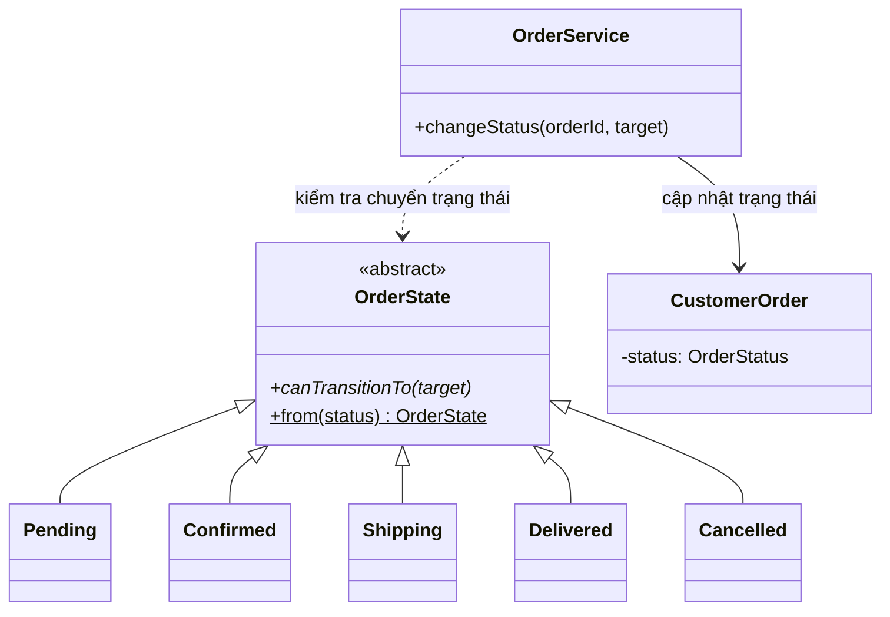

# Design Patterns trong bản Java

## Singleton

Spring quản lý `StoreMetadata` (`service/StoreMetadata.java`) mặc định với scope singleton: một instance cho toàn ứng dụng, giữ tên cửa hàng lấy từ cấu hình. Không dùng singleton cho JPA EntityManager/Repository có state theo transaction.

## Repository

`AppUserRepository`, `ProductRepository`, `CategoryRepository`, `CustomerOrderRepository` và `OrderItemRepository` là Spring Data JPA repositories. Service/controller gọi các interface này thay vì viết SQL trực tiếp. `OrderService` gom thao tác nhiều entity trong một transaction.

## Strategy và Factory

`PaymentStrategy` định nghĩa hành vi lấy hướng dẫn thanh toán. `CodPaymentStrategy` và `BankTransferPaymentStrategy` là các strategy cụ thể. `PaymentFactory.create(PaymentMethod)` chọn strategy từ danh sách bean do Spring inject. Hiện thanh toán chỉ mô phỏng; chưa gọi ngân hàng hoặc gateway.

## Observer

`OrderStatusObserver` là observer interface; `CustomerOrderObserver` và `AdminOrderObserver` nhận sự kiện sau khi trạng thái đổi hợp lệ và lưu thông báo vào database cho khách hàng/quản trị viên. `OrderCreatedObserver` thông báo admin khi có đơn mới. Các observer được gọi bên trong transaction của `OrderService`, vì vậy thông báo và thay đổi đơn cùng commit/rollback. Người dùng xem thông báo và đánh dấu đã đọc tại `/notifications`; chưa gửi email/SMS/push thật.

## State

`OrderState` đóng gói quy tắc chuyển trạng thái của đơn hàng. `Pending`, `Confirmed`, `Shipping`, `Delivered` và `Cancelled` là các trạng thái cụ thể; mỗi trạng thái quyết định trạng thái tiếp theo có hợp lệ hay không. `OrderService.changeStatus` lấy State tương ứng với trạng thái đang lưu rồi hỏi State trước khi cập nhật. Hai trạng thái `Delivered` và `Cancelled` là trạng thái kết thúc. Khi chuyển sang `Cancelled`, service vẫn hoàn lại tồn kho trong cùng transaction.

Luồng hợp lệ: `PENDING → CONFIRMED → SHIPPING → DELIVERED`; đơn có thể chuyển sang `CANCELLED` từ `PENDING`, `CONFIRMED` hoặc `SHIPPING`. State không thay thế `OrderStatus` được lưu trong cơ sở dữ liệu; nó tách quy tắc hành vi khỏi service và entity.

## Luồng đặt đơn

`CartController` nhận checkout form và session cart, `OrderService.placeOrder` chạy transaction `SERIALIZABLE`, đọc lại tồn kho từ DB, tạo `CustomerOrder`/`OrderItem` với snapshot giá, giảm kho và tăng số đã bán. Transaction lỗi sẽ rollback; sau thành công controller mới xóa session cart và hiển thị confirmation.

## Câu hỏi vấn đáp nhanh

1. **Tại sao StoreMetadata là Singleton?** Tên cửa hàng là cấu hình dùng chung, không đổi theo request.
2. **Tại sao không Singleton repository?** Spring Data repository/stateless bean do container quản lý; transaction/JPA persistence context có scope riêng.
3. **Factory làm gì?** Chọn implementation thanh toán theo `PaymentMethod` mà controller không cần tự khởi tạo class cụ thể.
4. **Strategy khác Factory ra sao?** Strategy đóng gói hành vi thay thế được; Factory chọn strategy cần dùng.
5. **Thêm payment method cần đổi đâu?** Thêm enum, implement `PaymentStrategy`, đăng ký bean và cập nhật validation/form.
6. **Observer hiện thông báo bằng cách nào?** Lưu thông báo trong database và hiển thị ở `/notifications`; chưa gửi email/SMS/push.
7. **State giải quyết vấn đề gì ở đơn hàng?** Mỗi trạng thái đóng gói các chuyển tiếp hợp lệ, tránh để quy tắc chuyển trạng thái thành một switch lớn trong service.
8. **State khác Strategy ở đâu?** State thay đổi hành vi theo trạng thái hiện tại của đối tượng; Strategy được chọn để thay thế một thuật toán/hành vi theo nhu cầu.
9. **Vì sao lưu `unitPrice` trong OrderItem?** Bảo toàn giá tại thời điểm mua kể cả khi giá catalog đổi.
10. **Làm sao chống bán vượt tồn?** Checkout dùng transaction Serializable và kiểm tra tồn kho mới nhất trước khi ghi đơn.
11. **Hủy đơn làm gì?** Chỉ cho hủy trước khi giao; cộng lại tồn kho và điều chỉnh số đã bán.
12. **Mật khẩu lưu thế nào?** BCrypt hash bằng Spring Security, không lưu plaintext.

Các test `OrderStateTest`, `OrderServiceTest` và `MacStudioApplicationTests` kiểm tra luật chuyển trạng thái, checkout/tồn kho, hoàn kho khi hủy đơn và quyền truy cập admin. Chạy bằng `./mvnw.cmd test`.

Sơ đồ use case, ERD, class diagram và sequence của bản Java nằm trong [docs/diagrams](docs/diagrams/). Báo cáo, hướng dẫn demo và giới hạn triển khai xem tại [FINAL_PROJECT_REPORT.md](FINAL_PROJECT_REPORT.md).