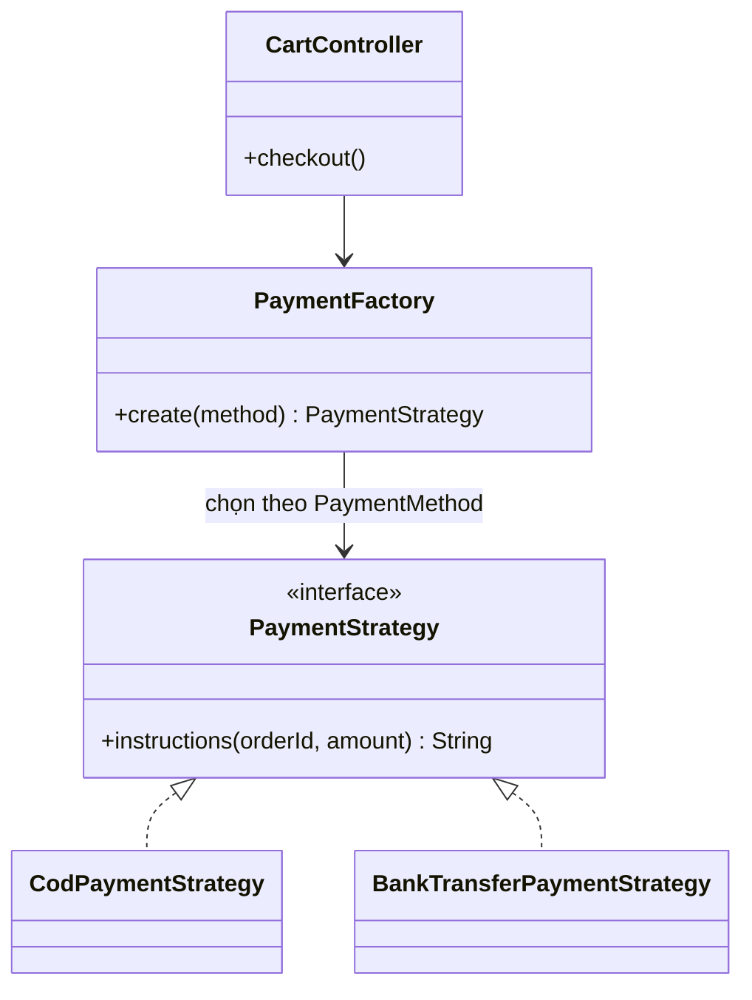
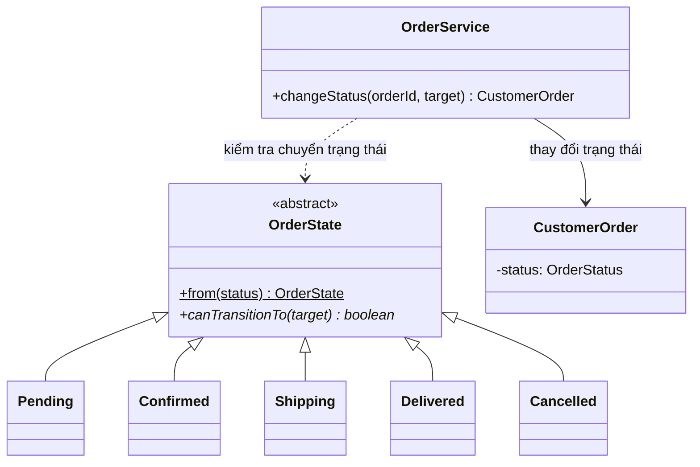
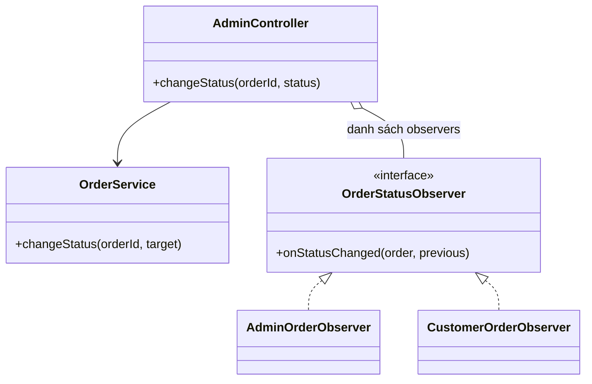
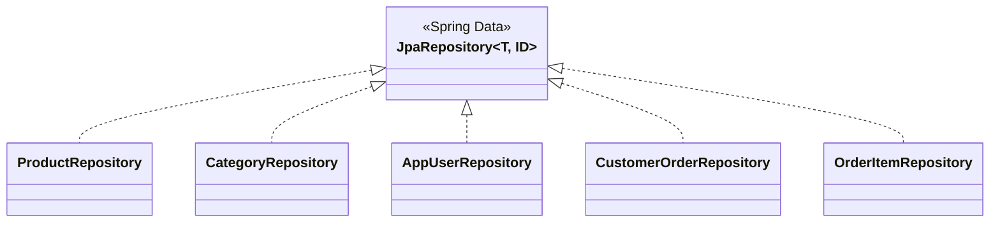

# Sơ đồ lớp các mẫu thiết kế

## Thanh toán: Strategy + Factory

## Vòng đời đơn hàng: State

Các trạng thái cụ thể là lớp lồng nhau `private` trong `OrderState`; hình biểu diễn vai trò của chúng, không hàm ý mỗi trạng thái là một file công khai riêng.

## Thông báo thay đổi trạng thái: Observer

## Truy cập dữ liệu: Repository

Spring quản lý `StoreMetadata` theo singleton scope. Đây là singleton do container quản lý, không phải triển khai Singleton GoF bằng constructor riêng/static accessor.
