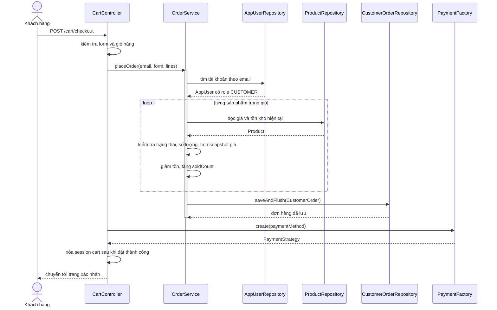
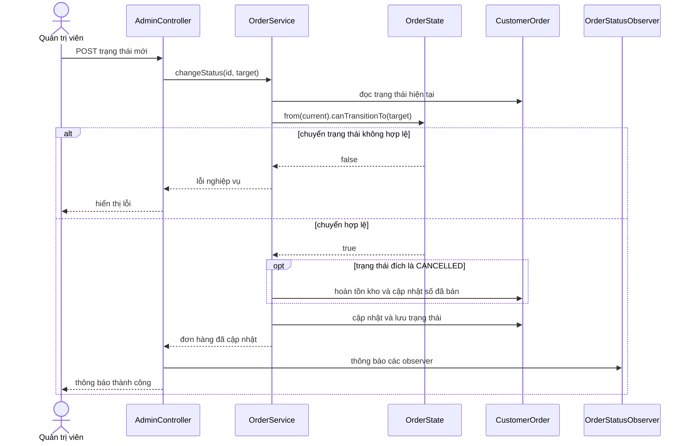

# Sơ đồ tuần tự

## Đặt hàng

Nếu không đủ tồn kho, service ném `IllegalArgumentException`; transaction rollback các thay đổi tồn kho và đơn hàng không được lưu.

## Admin cập nhật trạng thái đơn

